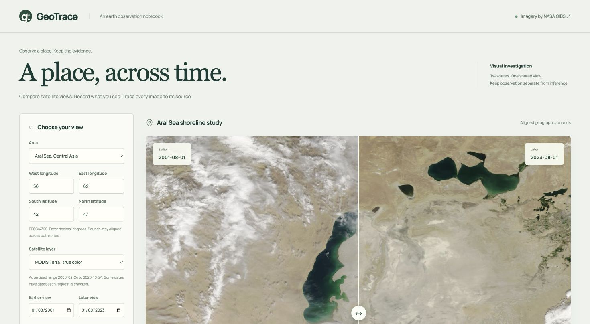

# GeoTrace

An earth-observation notebook for comparing satellite browse images across two
dates. Choose a place, inspect a shared geographic view, record what you see, and
save the exact source requests alongside your notes.



## Run

```sh
git clone https://github.com/ryanfer123/GeoTrace.git
cd GeoTrace
python3 -m geotrace
```

Open **http://127.0.0.1:8767**. Python 3.10+; no Python runtime packages or API keys.
The app binds to loopback and keeps investigations in a local SQLite database.
All browser fonts, icons, and motion libraries are served locally.

The first view is a real Aral Sea MODIS Terra reference pair from **2001-08-01** and
**2023-08-01**. Both original NASA GIBS JPEGs are bundled with request provenance,
so this comparison works offline. New dates or areas require a connection to NASA.

## What you can do

- Select Aral Sea, Lake Urmia, northern California, or a custom geographic box.
- Choose among MODIS Terra, MODIS Aqua, and VIIRS Suomi NPP true-color layers.
- Compare dates with a keyboard/touch-accessible split slider.
- Inspect exact NASA requests, download sizes, retrieval times, and SHA256 hashes.
- Save observation notes and reopen investigations after restarting the app.
- Export complete investigation JSON or a readable Markdown report.
- Refresh NASA's advertised date availability when the bundled metadata gets old.

## A traceable visual workflow

Enter bounds as **west, south, east, north** in decimal degrees. The server uses
**WMS 1.1.1, EPSG:4326**, with explicit longitude/latitude order and an explicit
`TIME` value for each image. Both images use the same layer, bounds, and dimensions.
Antimeridian-crossing boxes are not currently supported.

Dates are checked against the exact daily intervals NASA advertises, including
gaps. No nearest-date substitution is requested. An advertised day can still have
clouds, missing coverage, or a blank scene. Source failures are shown explicitly.
The metadata snapshot was verified on 2026-10-24; the refresh button updates the
current server session's catalog.

The cache validates image signatures and hashes. Saved image URLs are content
addressed: a later reprocessed NASA image does not silently replace a previously
saved image. Reports retain the original source URLs, response hashes, acquisition
request dates, metadata date, and local retrieval time. The dates label requested
GIBS data days, not an independent verification of sensor acquisition timestamps.

## Interpretation limits

These are browse images for **visual inspection**. Clouds, haze, season, view angle,
missing observations, sensor differences, and processing can affect appearance.
The application does not compute NDVI, burn severity, water-loss area, or causal
attribution. A visual difference is an observation to investigate, not an automatic
environmental conclusion.

## Development and checks

```sh
python3 -m unittest discover -s tests -v
python3 -m pip wheel . --no-deps -w dist
```

The suite covers date gaps, geometry validation, WMS axis order, source errors,
cache integrity, immutable saved images, closed database connections, local request
boundaries, and the complete compare/save/export HTTP workflow. The wheel packages
all frontend assets and NASA reference images. GitHub Actions tests Python 3.10,
3.12, and 3.13 and builds the package.

Use a separate local workspace when needed:

```sh
python3 -m geotrace --port 8792 --database field.sqlite3 --cache .field-images
```

This is a single-user local app. It does not provide accounts, multi-user access
control, remote deployment, or a scientific raster-processing pipeline.

## Design and assets

The image-led interface follows a field-notebook direction: mineral surfaces,
forest-green controls, editorial typography, and quiet source annotations. GSAP
introduces the headline and image frame. Lenis is the sole smooth-scroll engine;
reduced motion bypasses it. Three.js is omitted because the source imagery should
remain readable and geographic controls should stay in normal document flow.

[Asset provenance](THIRD_PARTY.md) lists exact dependencies and image sources.
[Contributing](CONTRIBUTING.md) describes the development contract.
[Validation evidence](docs/VALIDATION.md) records tests and desktop/mobile checks.

## Sources and license

Imagery: **NASA EOSDIS Global Imagery Browse Services (GIBS)**.
[Service documentation](https://nasa-gibs.github.io/gibs-api-docs/access-basics/)
describes supported WMS endpoints, time dimensions, and projections.

Application source: MIT. Third-party assets retain their original terms; see
[THIRD_PARTY.md](THIRD_PARTY.md).
